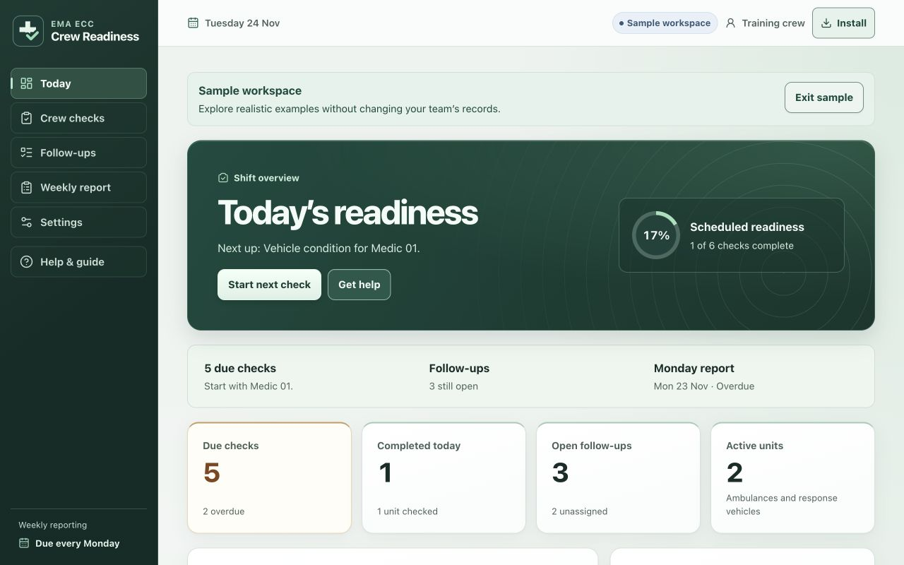

# EMA ECC Crew Readiness

**A SolarSpin Technologies case study**

EMA ECC Crew Readiness brings recurring medication, ambulance equipment and vehicle checks into one workspace. Crews can see what is due, complete the right checklist for their unit and record an exception as it happens. Supervisors can then track the follow-up and prepare the Monday report from the checks already recorded.

[Open EMA ECC Crew Readiness](https://ema-cr.pages.dev/). Staff sign in with their crew readiness account. The [illustrated case study](index.html) is also available as a standalone HTML page in this repository.

## The shift workflow

The brief called for regular checks and a weekly report every Monday. The design starts with what the next person needs to do at each handover.

| Moment | What the dashboard provides |
| --- | --- |
| Start of shift | A due queue based on the active fleet and the intervals set by the supervisor. |
| During the check | Section-by-section entry for quantities, equipment condition, explanations and vehicle mileage. A completion indicator and a shortcut to the next unanswered item help crews resume where they left off. |
| When a problem is found | Stock differences and faults become traceable follow-ups after the signed check is submitted. The supervisor can assign an owner, set a due date and record the resolution. |
| Monday review | The prior week’s figures are calculated from saved records. The supervisor adds context and submits a dated snapshot, with print and CSV exports and a recurring calendar reminder available. |

The report includes the operational counts and mileage so staff can spend their writing time on what happened and what needs action. Windhoek time determines which week a record belongs to and when the Monday report is due.

## Designed for the equipment bay and the office

- **A clear first action.** Today highlights the due check, open follow-ups and Monday report. Supervisors can set schedules by checklist, and on-demand checks remain available.
- **The right fields for the unit.** Unit type and crew level determine checklist sections and expected quantities. Actual counts, a zero balance and an explicit not-applicable answer carry distinct meanings.
- **A record the next shift can use.** Signed history, targeted follow-up filters and the latest counted stock help crews see what was checked and what still needs attention.
- **Continuity on a weak connection.** In-progress checks and report notes stay in the current browser tab’s session. Staff submit operational records after reconnecting. The dashboard can be installed on supported browsers, and its Help view includes screenshots and a sample workspace for practice.
- **A workspace by role.** Staff sign in through the dashboard. Supervisors can invite staff, manage access, assign and close findings, and submit the weekly report. Crew members record checks and review follow-ups.
- **Weather alongside shift context.** The Today view shows available airport observations for selected Namibian stations. Practice mode displays a fictional weather reading.

## Architecture

The React and Vinext interface uses small browser modules for checklist, scheduling and reporting behavior. Server routes validate submissions and enforce workspace membership and write permissions. Cloudflare D1 stores shared operational history, settings and submitted report snapshots. Drizzle migrations manage the schema.

The scheduling, inventory and reporting functions take recorded inputs and produce repeatable results. The browser updates completion and exception indicators as crews enter their answers. The server checks that findings appended by a crew member match the signed checklist. A version check protects concurrent edits from silently replacing newer work.

## Verification

The release verification included **32 passing automated tests** and browser checks of dashboard sign-in, enrollment and team administration. The suite exercised Windhoek week boundaries, daily and weekly cadence, crew-specific quantities, zero stock, missed answers, issue creation, role restrictions, report totals, mileage validation, spreadsheet-safe export and the offline fallback. The weekly report keeps its figures as they stood when submitted.

The deployed dashboard is hosted on Cloudflare Pages. The screenshot shows the sample workspace with fictional units and figures.

**SolarSpin Technologies** · [Company website](https://www.solarspin-namibia.xyz/)
